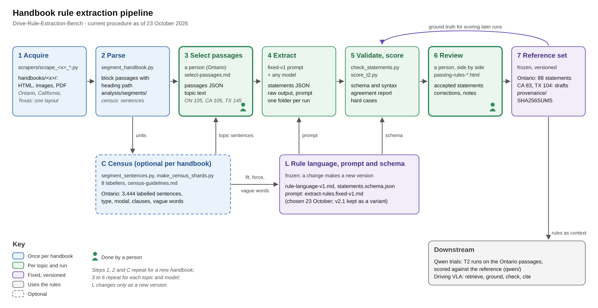
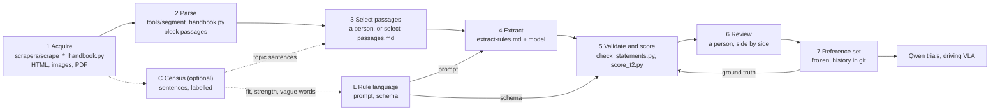

# Rule extraction pipeline

The procedure the project uses to turn a driver's handbook into Rule Language statements (`analysis/rule-language.md`). Steps 1, 2 and C run once per handbook. Steps 3 to 6 run for each topic and each model. Step L is fixed between runs; a change to it is a commit, and git keeps every earlier version. The extraction prompt is `prompts/extract-rules.md`, the prompt michael chose on 23 October for every handbook. Ontario's passing topic went through every step, and how each step was done for it is in `provenance/README.md`. California and Texas have been through steps 1 to 5: their passing rules were extracted with that prompt on 23 October (`extractions/{ca,tx}/`) and are drafts that no person has reviewed.

Since 28 October, Ontario also runs through the database in six stages, each reading and writing `db/rules.sqlite` only: import, tag, select, formalize, ground and validate (`db/README.md`). The first run of it is `on-passing-1`, compared with the reviewed set in `runs/on-passing-1/compare.md`. The table below is the file-based procedure that made the reviewed set.



`pipeline.svg` is the same figure as a vector file, drawn by `make_pipeline_svg.py`.

## Steps

| Step | What it does | Inputs | Who or what | Outputs |
|---|---|---|---|---|
| 1 Acquire | Save every handbook page with its images as clean local HTML in one shared layout, and keep the source PDF | The handbook's website or PDF | `scrapers/scrape_mto_handbook.py`, `scrapers/scrape_ca_handbook.py`, `scrapers/scrape_tx_handbook.py` | `handbooks/mto/` (29 pages, 241 images, with the ontario.ca PDF), `handbooks/ca/` (23 pages, 74 images, with the DMV PDF), `handbooks/tx/` (21 pages and 203 images converted from the Texas PDF, each block tagged with its PDF page). Each was checked against its source |
| 2 Parse | Split the pages into passages, one per paragraph, list item, table row or figure, each with its heading path | `handbooks/<x>/` | `tools/segment_handbook.py` | `analysis/segments/{mto,ca,tx}.jsonl` |
| C Census (optional) | Split the pages into sentences and label every one with type, role, modal, strength basis, clauses, vague words and topic, to check that the rule language fits the handbook and to find topic sentences on other pages | The handbook HTML, `analysis/census/census-guidelines.md` | `provenance/scripts/segment_sentences.py`, `provenance/scripts/make_census_shards.py`, 8 model labellers with `provenance/prompts/census-labelling.md`, `provenance/scripts/validate_labels.py` | Ontario only: `analysis/census/census-labels.jsonl` (3,444 sentences), summary and report |
| L Language, prompt and schema | The statement format, the rules for law or advice (strength), the wording rules, the extraction prompt and the output schema | Template table, prior work, census, reviewers' comments | Designed 10 to 11 October; deontic modality, strength, structured actions and EITHER … OR added 26 October | `analysis/rule-language.md`, `analysis/passing-rules/statements.schema.json`, and the prompt `prompts/extract-rules.md` with its topic files in `prompts/topics/` |
| 3 Select passages | Choose the passages for a topic and write the topic text | Segments, census topic flags | Ontario: michael by hand, plus 9 sentences the census found. California and Texas: Claude subagents with `prompts/select-passages.md`, then `tools/make_passages.py` | `analysis/passing-rules/mto/inputs/passing-passages.json` and `census-sentences.json` (Ontario, m1 to m96 and c1 to c9), `analysis/passing-rules/{ca,tx}/inputs/passing-passages.json` (p1 to pN); the topic text in `prompts/topics/` |
| 4 Extract | Fill the prompt with the passages and run a model | Passages, topic text, prompt | `provenance/scripts/render_prompt.py` renders the messages (all passages, or one page with `--page`); `qwen/run_extract.py` sends them page by page to a vLLM server. The Qwen runner can also build its own prompt with `qwen/build_prompt.py` | One folder per run with the exact prompt, the raw answers and the statements |
| 5 Validate and score | Check the output against the schema and the language, then compare it with the reference | Statements, reference, passages | `tools/check_statements.py`; `qwen/score_t2.py` and `qwen/compare_t2.py` (`--pairing fixed` pairs by shared sources, like `provenance/scripts/score_extraction.py`) | Problems found, then recall, precision, agreement on type, strength and modals, vague-word F1, hard cases, unused passages |
| 6 Review | A person reads each statement beside its sources and accepts or corrects it | Statements, passages | A person, with the side-by-side pages: `pages/passing-rules.html` (Ontario) and `pages/passing-rules-{ontario,california,texas}.html` from `tools/build_rules_page.py` | Accepted statements and corrections |
| 7 Reference set | Freeze the reviewed statements as the topic's reference | Reviewed statements | One file per handbook, with its history in git, plus provenance | Ontario: `analysis/passing-rules/mto/rules.json` (88 statements, the reference since 23 October), `provenance/`. California 83 and Texas 104: `analysis/passing-rules/{ca,tx}/rules.json`, drafts from the 23 October extractions, not yet reviewed. Each folder also has `passing-rules.md`, the same statements as a readable page |

## Input format for step 4

One JSON object per passage, in handbook order. For Ontario's passing passages:

```json
{"id": "m17", "page": "Changing positions page · Chapter 2", "sec": "Passing", "kind": "text", "text": "Passing left of a centreline is not permitted 30 metres from a bridge, viaduct or tunnel."}
{"id": "m25", "page": "Signs", "sec": "Regulatory signs · image", "kind": "figure", "text": "a regulatory sign", "cap": "Alt text: “a regulatory sign”", "image": "images/3-1-22.jpg"}
```

Fields that would give answers away (`part`, `cls`, `w`, `grp` in the Ontario inputs) are never sent. Image paths are relative to the handbook folder; send the image itself only when the model takes images and the run records that it did. The Qwen T2 runs so far sent captions and alt text, not images.

## Running it on a new handbook

1. Acquire: adapt a scraper in `scrapers/` so it writes the shared layout into `handbooks/<x>/` (one HTML file per page with `<main>`, `<h1>`, `<article class="content">`, a table of contents in `index.html`, and an `images/` folder). Keep the source PDF and check the text against the source.
2. Parse: run `tools/segment_handbook.py` to write `analysis/segments/<handbook>.jsonl`. If the HTML differs, adapt the parser, not the passage format.
3. Census (recommended for a handbook from a new jurisdiction): run `provenance/scripts/segment_sentences.py` and `provenance/scripts/make_census_shards.py`, the labelling prompt on each shard, and `provenance/scripts/validate_labels.py`. If many sentences do not fit, propose changes to the language and the prompt, and make them in one commit.
4. Select the passages for the topic with `prompts/select-passages.md` and `tools/make_passages.py`, and write the topic text.
5. Extract with `prompts/extract-rules.md`, rendered by `provenance/scripts/render_prompt.py` with the topic text. Check with `tools/check_statements.py`.
6. Score against a reference where one exists, then review.

## Rules for every run

- The local copy is the handbook's source. Steps 2 to 7 read only `handbooks/<x>/` on the server, never the live website, so every passage can be traced to a saved file. Record the copy's sha256 sums (as `provenance/SHA256SUMS` does for Ontario's 272 files) and the date it was saved. A new download is a new copy with its own date and sums, and runs on it are not compared with runs on the old copy without checking the differences.
- Use the prompt as it is. A change to the prompt is a commit; every run records the prompt's sha256 and the rendered text, and scores are only comparable between runs with the same prompt, scorer and pairing.
- Keep everything a run used and produced in one folder: the exact prompt, the inputs' sha256, the raw answers, the statements, the check and the score, and the sampling settings. The Qwen runner writes `runs/t2/<handbook>/<model>/<prompt version>/<think|nothink>/seed<k>/`; the check of the prompt is in `provenance/prompt-check/`, and the 23 October extractions of all three handbooks in `extractions/{mto,ca,tx}/`.
- Score by sources, not by ids. The Ontario reference ids follow michael's outline; the extraction prompt makes ids from the first source passage (`m17a`), and the Qwen runner numbers statements per page (`p03:s4`).
- Every score is agreement with a reference that no person has yet reviewed line by line. Read disagreements before counting them as errors.

## The same pipeline as a mermaid diagram


