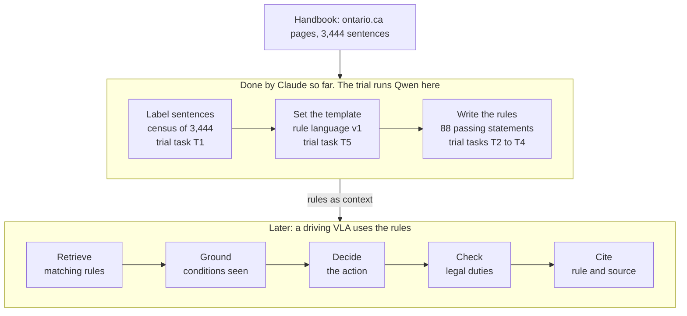

# Handbook rules: handoff for the Qwen trials

Oct 20, 2026 · michael

## Summary

We are turning the Ontario MTO Driver's Handbook into short, typed rules. A driving model can retrieve them, check them against a scene, and cite the handbook sentence behind each one. The rule language (v1) is written, and Claude has used it to turn the passing section into 88 statements, each tied to its handbook sentences, with vague words flagged.

This phase tests whether open Qwen models, from small ones up to 27B, can do the same work on our own server. Each model gets the same inputs and is scored against Claude's output on four tasks: labelling handbook sentences, extracting the passing rules into v1, deciding law or advice, and flagging vague words. A fifth, open-ended task asks each model to propose a rule template from scratch.

Next: install vLLM on the server, get the files listed under Files from the working repo, run the smallest model end to end, then move up in size.

**Update, 23 October.** The 88 statements are now the reference ruleset, and T2 uses one fixed prompt for every model and handbook: `prompts/extract-rules.fixed-v1.md`, chosen by michael on 23 October. Render it with `provenance/scripts/render_prompt.py` (one page at a time with `--page`) and send the rendered system and user messages, not the file itself. How the reference was made is in `provenance/`, and the whole pipeline is in `pipeline/PIPELINE.md`.

## What the project is

The handbook is written for people learning to drive, not for a machine that has to act on it. A rule's condition often sits only in a heading, its force (law or advice) is rarely stated, and vague words such as "safely" or "enough" look like any other word. We rewrite each rule once in a controlled, English-like language that makes all of this explicit, and every statement keeps the handbook sentences it came from.

One statement from the passing pilot, written out in full:

```
3.1.2a      RULE · LEGAL
            a driver MUST NOT pass [?on the left of a centreline] WHEN the driver is [?30 m from] a bridge, viaduct or tunnel
SOURCE      m17 "Passing left of a centreline is not permitted 30 metres from a bridge, viaduct or tunnel."
FORCE FROM  text ("is not permitted")
FLAGS       R "30 m from": read as "within 30 m of"; the text does not say whether both approaches count
            G "on the left of a centreline": prohibits the means, so passing near a bridge on a multi-lane road is not covered
```

- **The rule language (v1)** has five statement types: DEFINE, FACT, RULE, PROCEDURE (STEP n, IF … THEN) and EXCEPTION.
  - Modals separate law (MUST, MUST NOT, MAY) from advice (SHOULD, SHOULD NOT).
  - Clauses carry conditions: WHEN, WHILE, ONLY IF, UNLESS, UNTIL, BECAUSE, IF VIOLATED. Links join statements: EXCEPTION TO, SPECIALIZES, ALSO CALLED.
  - Each statement has an ID and a SOURCE, rules also give FORCE FROM, and any statement may carry TAGS, SEE and FLAGS.
  - Eight flag codes mark unclear wording: J judgment, S hedged scope, R unclear reference, G goal or means, M unclear force, D implicit default, V wording drift, X stated elsewhere.
  - Wording rules: "a driver" first, then "the driver"; one phrase per concept; thresholds are never invented.
- **The passing pilot** applies v1 to 96 passages michael picked about passing (85 text passages and 11 figures), plus 9 more passages the census found elsewhere in the handbook (8 sentences and 1 figure). The result is 88 statements, shown side by side with the handbook on the [Passing Rules](https://claude.ai/artifact/KVZ7S3NaydoYYfLXbZFd7v) page.
- **Why a VLA.** A vision-language-action model for driving could take these rules as context, retrieved like RAG. It would ground each condition in what it sees and cite the rule behind each action, so a checker or a person can trace the decision back to the handbook.



Claude did the three middle steps for the passing section. The trial gives Qwen the same inputs at each step and compares its output with Claude's.

## Goals

The long-term goal is a rule set for the whole handbook that a driving VLA can use as grounded, traceable context. For each scene it would retrieve the rules that apply, ground their conditions in what it perceives, and decide. A checker would then test the action against the legal duties, and the model would cite the rule and its handbook sentence.

This phase asks how much of the rule work an open model can do on our own server, and at what size. Claude has shown it can propose the template, extract the rules and flag vague words. We expect open models can do much of it too, since the work is a kind of document summarization and organization. The trial answers five questions:

1. Given the v1 spec, does the model write valid statements with the right type, modal, conditions, links and sources?
2. Does it decide law or advice correctly, and give the reason (FORCE FROM)?
3. Does it find the vague words and give each the right flag code?
4. Without the spec, does it propose a usable template of its own?
5. Where does quality drop as models get smaller, and does thinking mode help?

The outcome is, for each task, the smallest model whose output is close enough to the reference to use with light review. Our guess, to be tested: format and statement types will hold up even in small models. The hard parts should be what the handbook leaves implicit: conditions held in headings, force set by a heading, rules split across passages, and vague words.

Why open models: the whole handbook (3,444 sentences) can be run many times at no per-token cost. Fixed weights make runs reproducible, the text stays on our server, and a model that falls short can be fine-tuned later on hand-checked rules.

## Progress so far

The passing pilot is complete: the language is specified, the 88 statements are written, and the review page is up. All of it was done on 10 and 11 October 2026, with Claude doing the labelling and extraction.

| Step | What it produced | Where |
| --- | --- | --- |
| 1. Content structure | How the handbook organises passing: definition, general procedure, restrictions and cautions, special conditions | `analysis/passing-content-structure.md` |
| 2. Template plan (v0) | First grammar draft, the census method, flags for vague words, prior work; now superseded by v1 | `analysis/rule-template-plan.md` |
| 3. Census | All 3,444 handbook sentences labelled against v0 (type, role, modal, clauses, vague words, a v0 rewrite). It showed v1 needed UNTIL, FORCE FROM and SEE | `analysis/census/` |
| 4. Rule language v1 | The spec the trial gives to each model | `analysis/rule-language-v1.md` |
| 5. Passing pilot | 88 statements with sources, force reasons, flags and notes | `analysis/passing-rules/passing-rules.v1.json` |
| 6. Review page | Handbook and rules side by side; click either side to jump to the other (version 8) | [Passing Rules](https://claude.ai/artifact/KVZ7S3NaydoYYfLXbZFd7v) |
| 7. VLA notes | Where rules can enter a VLA, a grounding layer, and what normalizing gains over raw text | `analysis/vla/` |

The 88 statements are 71 rules, 9 facts, 4 definitions, 2 procedures and 2 exceptions. Of the 73 rules and procedures, 19 are law (8 MUST, 7 MUST NOT, 4 MAY) and 54 are advice. 53 statements carry 72 flags, 40 of them J (judgment), and 50 vague spans are marked inline as `[?…]`.

Still open:

- [ ] A person checks the census labels and the 88 statements. Both are Claude's output and have not been reviewed line by line.
- [ ] Fill in TAGS, which v1 specifies but the JSON leaves empty.
- [ ] Build the grounding layer for the 15 legal duties (8 MUST, 7 MUST NOT); 10 become checkable once their facts are grounded.
- [ ] Compare retrieval over raw sentences, raw paragraphs with headings, and normalized statements.
- [ ] Extend the rules beyond passing to the rest of the handbook, with a register of vague terms.
- [ ] Run this trial: open models on the same tasks.

## Files

Everything the trial needs is in the working repo, [Drive-Rule-Extraction-Bench](https://github.com/hennyg888/Drive-Rule-Extraction-Bench). The handbook pages were already there in `mto_drivers_handbook/`, which moved to `handbooks/mto/` on 23 October. The rule files below were added in `analysis/`, a snapshot of 20 October 2026, and this document is `qwen-trial-handoff.md` at the top of the repo. Paths below are relative to the repo root, and to `Wise Lab/` in the project, where the Ontario handbook is still at `mto_drivers_handbook/`.

| File | What it holds | Use in the trial |
| --- | --- | --- |
| `analysis/rule-language-v1.md` | The v1 spec, about 15k characters | Prompt for T2 to T4 |
| `analysis/passing-rules/inputs/passing-passages.json` | michael's 96 passages: `m` (m1 to m96), `page`, heading path `sec`, `text`, `kind`; figures add `src` (image) and `cap` (caption). `part` keeps his grouping: intro, general, specific, excluded | Input for T2 and T5 |
| `analysis/passing-rules/inputs/census-sentences.json` | 9 more passages about passing found by the census (c1 to c9; c9 is a figure), each with its `census_id` | Input for T2 and T5 |
| `analysis/passing-rules/passing-rules.v1.json` | The 88 statements: `id`, `type`, `force`, `force_from`, `text`, `sources` (passage id and quote), `flags` (code, span, note), `links`, `see`, `steps` | Reference for T2 to T4 |
| `analysis/passing-rules/statements.schema.json` | JSON Schema for a model's T2 output: the statement fields above, minus the display-only ones. All 88 reference statements pass it once section, see, where, image, census\_id and zh are dropped | Structured output for T2 |
| `analysis/census/census-guidelines.md` | The census labelling instructions (v0 grammar) | Prompt for T1 |
| `analysis/census/census-labels.jsonl` | 3,444 sentences, one JSON object per line: `id`, `page`, `section`, `kind`, `text`, `label` | Input and reference for T1 |
| `analysis/vla/normalized-vs-raw.md` | Where raw handbook text is weakest | Source of the hard cases |
| `handbooks/mto/` | The handbook pages saved from ontario.ca, with 241 images; each page shows its own update date, from August 2022 to September 2026 | Figures, and sections beyond passing |
| `pages/` | Copies of the two published pages: `passing-rules.html` (the 88 statements beside the handbook) and `passing-topic-comparison.html` (michael's 96 passages). Their images load from `handbooks/mto/images/` | Reading the statements beside their sources |

The two input files and the schema were added today; the inputs are copies of the passages behind the Passing Rules page. The excluded passages (m92 to m96) use "pass" to mean "go past", so a good model writes no passing rule from them.

When building prompts, send only `page`, `sec`, `text` and `cap`. The `part` and `cls` fields mark m92 to m96 as excluded and would give that answer away. Image paths in `src` are relative to `handbooks/mto/`.

## The open-model trial

Each model does five tasks, from narrow to open. T1 to T4 are scored automatically against Claude's output, and T5 is read by a person. Every score measures agreement with Claude, not correctness, so look at each disagreement before counting it wrong.

| Task | The model gets | It returns | Reference | Main score |
| --- | --- | --- | --- | --- |
| T1 Label sentences | `census-guidelines.md`, then handbook sentences with their headings, about 100 at a time | One label object per sentence | `census-labels.jsonl`, 3,444 sentences | Agreement on type, modal, force basis, clauses and the passing flag; F1 on vague words |
| T2 Extract rules | The fixed-v1 prompt (the v1 format, force rules, vocabulary and worked examples from outside the passing topic) with one handbook page's passages and their heading paths | v1 statements as JSON | `passing-rules.v1.json`, 88 statements | Statement recall and precision, then the checks below |
| T3 Decide force | The force rules from v1, one reference rule with its modal blanked, and its source passages with headings | A modal and its FORCE FROM | Force: the 73 rules and procedures. Modal: the 71 rules, 6 with two modals | Law or advice accuracy; exact modal |
| T4 Flag vague words | The flag codes from v1, one reference statement with its `[?…]` marks removed, and its sources | Spans with flag codes | 72 flags on 53 statements; 49 mark a span inline | Span F1 on the 49 inline spans; code accuracy on matched spans, leaving out X (stated elsewhere), which needs other pages |
| T5 Propose a template | The passing passages and no spec, with the task: design a rule template, then apply it to 10 passages | A template and 10 rules | v1, for comparison only | A person compares it with v1 |

T2 pairs each model statement with the reference statement that shares its source passages (the closest wording when several do), then checks:

- The output is valid v1: known keywords, the five modals, "a driver" then "the driver".
- Type, force (law or advice) and modal match.
- Every reference condition (WHEN, WHILE, ONLY IF, UNLESS, UNTIL) appears in the model's statement. A judge model compares the wording, and a person checks a sample of its calls.
- Sources and links match; the reference has 5 links.
- No number appears that is not in the sources or their headings; number words count, so "one metre" matches 1 m.
- Vague words are flagged as in T4.

Hard cases are scored separately, because raw text is weakest there:

- conditions held only in a heading (15): 3.1.7a, 3.2.1d, 3.2.2a, 3.3.1b, 3.3.2a, 3.3.2b, 3.3.3a, 3.3.3b, 3.4.4a, 3.4.4c, 3.4.5d, 3.4.7a, 3.4.8a, 3.5.2a, 3.6.1d;
- conditions held only in a neighbouring passage (2): 2.2b, 3.1.4a;
- legal force set only by a heading (3): 3.1.7a, 3.2.1d, 3.6.1c;
- links between different passages (3): 2.2b and 3.3.1b to 2.2a, and 3.4.12e to 3.4.12b;
- a duty written apart from its penalty (4): 3.4.4b, 3.4.12b, 3.4.13a, 3.4.13b;
- statements whose sources sit on two pages (6): 3.1.1a, 3.4.13a, 3.4.13b, 3.6.1a, 3.6.3a, 3.6.3b;
- passages that should give no passing rule: m92 to m96.

Protocol:

1. Use one fixed prompt per task for every model. Save the prompt, raw output and parsed output of every run.
2. Take the worked examples from outside the hard cases (for example 1d, 2.1a and 3.1.2a) and leave them out of the scores. The T2 prompt's examples come from outside the passing topic, so all 88 statements count for T2.
3. Run T2 one handbook page at a time to keep outputs short. Then run the largest model once on all pages together, for the 6 statements whose sources sit on two pages.
4. Enforce the JSON schema with vLLM's structured outputs, so scores measure content rather than formatting.
5. Run each model with thinking on and off, three seeds each, at the sampling settings under Server setup. Report the mean and the spread.
6. Run the smallest model end to end first to shake out the pipeline, then the rest.

## Server setup

vLLM serves each model behind an OpenAI-compatible API, so one set of trial scripts works for every size. Install the current vLLM, 0.32.0 (18 October 2026); the vLLM recipes list 0.17.0 as the minimum for these models. The Qwen3.5 model cards still say vLLM must be built from its main branch, which is out of date.

Models: the Qwen3.5 family gives a clean size ladder from one training recipe, and Qwen3.8-27B is the newest open 27B. All are Apache-2.0, with a 262k-token context and a built-in vision encoder.

| Model | Released | Weights (BF16) | Fits on | Thinking by default |
| --- | --- | --- | --- | --- |
| [Qwen3.5-0.8B](https://huggingface.co/Qwen/Qwen3.5-0.8B) | Mar 2026 | about 2 GB | any recent GPU | No |
| [Qwen3.5-2B](https://huggingface.co/Qwen/Qwen3.5-2B) | Mar 2026 | about 4 GB | any recent GPU | No |
| [Qwen3.5-4B](https://huggingface.co/Qwen/Qwen3.5-4B) | Mar 2026 | about 8 GB | one 16 GB GPU | Yes |
| [Qwen3.5-9B](https://huggingface.co/Qwen/Qwen3.5-9B) | Mar 2026 | about 18 GB | one 24 GB GPU at short context; 40 GB is comfortable | Yes |
| [Qwen3.5-27B](https://huggingface.co/Qwen/Qwen3.5-27B) | Feb 2026 | 55.6 GB; FP8 30.9 GB | BF16: 2×H100, 1×H200, or one 80 GB GPU at 64k context (my estimate). FP8: one 48 GB GPU | Yes |
| [Qwen3.8-27B](https://huggingface.co/Qwen/Qwen3.8-27B) | Aug 2026 | 55.6 GB; FP8 30.9 GB | Same as Qwen3.5-27B | Yes |

Sizes marked "about" assume 2 bytes per parameter. The KV cache comes on top, and FP8 runs fastest on Hopper or Ada GPUs such as the H100 or L40S.

**1. Install.** The default vLLM wheel is built for CUDA 13.0, so check the driver first.

```bash
nvidia-smi   # the "CUDA Version" shown must be 13.0 or higher; if lower, use the image vllm/vllm-openai:v0.32.0-cu129

curl -LsSf https://astral.sh/uv/install.sh | sh
source $HOME/.local/bin/env       # puts uv on the PATH in this shell
mkdir -p ~/qwen-trial && cd ~/qwen-trial   # keep the venv outside the repo
uv venv --python 3.12 --seed      # vLLM supports Python 3.11 to 3.14
source .venv/bin/activate
uv pip install vllm --torch-backend=auto
vllm download-kernels             # prebuilt kernels, saves minutes at each start

git clone https://github.com/hennyg888/Drive-Rule-Extraction-Bench.git ~/Drive-Rule-Extraction-Bench   # the files under Files
export HF_HOME=/data/hf           # any disk with about 150 GB free; set it again in any new shell before vllm serve
for m in 0.8B 2B 4B 9B 27B; do hf download Qwen/Qwen3.5-$m; done
hf download Qwen/Qwen3.8-27B
```

**2. Serve one model at a time.** Start with the smallest: put `Qwen/Qwen3.5-0.8B` and `qwen3.5-0.8b` in place of the 27B names below. In a new shell, first run `cd ~/qwen-trial && source .venv/bin/activate` and set `HF_HOME` again.

```bash
vllm serve Qwen/Qwen3.5-27B \
  --served-model-name qwen3.5-27b \
  --language-model-only \
  --reasoning-parser qwen3 \
  --max-model-len 65536 \
  --tensor-parallel-size 1 \
  --gpu-memory-utilization 0.90 \
  --port 8000
```

- `--language-model-only` skips the vision encoder and leaves more memory for the KV cache. Drop it if the figures go in as images.
- `--reasoning-parser qwen3` returns the thinking in `message.reasoning` and the answer in `message.content`, for Qwen3.5 and Qwen3.8 alike.
- `--tensor-parallel-size 2` splits a model across two GPUs. For FP8, serve `Qwen/Qwen3.5-27B-FP8` or `Qwen/Qwen3.8-27B-FP8` with the same flags; each FP8 build needs about 31 GB more disk.
- If startup fails with a CUDA graph or Mamba cache size error, lower `--max-cudagraph-capture-size` (default 512). If runs stop at `max_tokens`, raise it; raise `--max-model-len` only when the prompt plus `max_tokens` exceeds 65,536.

**3. Smoke test with structured output.** The `openai` package comes with vLLM. vLLM applies the schema to the answer only, after any thinking. Run it from the repo root with the venv active.

```python
import json
from openai import OpenAI

MODEL = "qwen3.5-0.8b"   # the --served-model-name of the running server
client = OpenAI(base_url="http://localhost:8000/v1", api_key="EMPTY")
schema = json.load(open("analysis/passing-rules/statements.schema.json"))

r = client.chat.completions.create(
    model=MODEL,
    messages=[{"role": "user", "content":
        "Write this handbook passage as rule language v1 statements. Passage m17: "
        "'Passing left of a centreline is not permitted 30 metres from a bridge, viaduct or tunnel.'"}],
    response_format={"type": "json_schema", "json_schema": {"name": "statements", "schema": schema}},
    temperature=1.0, top_p=1.0, presence_penalty=0.0, max_tokens=8192, seed=1,   # 0.8B with thinking off; see Sampling
    extra_body={"top_k": 20, "chat_template_kwargs": {"enable_thinking": False}},
)
print(r.choices[0].message.content)
```

For a thinking run, set `"enable_thinking": True` instead (the 0.8B and 2B default to off), use the thinking settings below, and read the thinking from `r.choices[0].message.reasoning`. Change `seed` for each of the three runs per setting. Send requests concurrently, for example 16 at a time, and vLLM batches them on the GPU.

**4. Sampling.** Each card gives its own settings:

| Model and mode | temperature | top\_p | top\_k | presence\_penalty on the card |
| --- | --- | --- | --- | --- |
| Qwen3.5 4B to 27B, thinking | 1.0 | 0.95 | 20 | 1.5 |
| Qwen3.5 4B to 27B, thinking off | 0.7 | 0.8 | 20 | 1.5 |
| Qwen3.5 0.8B and 2B, thinking off (their default) | 1.0 | 1.0 | 20 | 2.0 |
| Qwen3.5 0.8B and 2B, thinking | 1.0 | 0.95 | 20 | 1.5 |
| Qwen3.8-27B, thinking | 1.0 | 0.95 | 20 | 0.0 |
| Qwen3.8-27B, thinking off | 0.7 | 0.8 | 20 | 1.5 |

Use each card's temperature, top\_p and top\_k, but set presence\_penalty to 0 for every run. v1 repeats the same phrases on purpose ("a driver", "the driver", WHEN), and a penalty on repeated words pushes a model to vary them. Cap `max_tokens` instead, and count the runs that hit the cap: the 0.8B and 2B cards warn that thinking can loop. Qwen3.8 also takes a reasoning\_effort level, xhigh by default; keep the default.

Sources: [Qwen3.5-27B card](https://huggingface.co/qwen/Qwen3.5-27B), [Qwen3.8-27B card](https://huggingface.co/Qwen/Qwen3.8-27B), [Qwen3.5-0.8B card](https://huggingface.co/Qwen/Qwen3.5-0.8B), [vLLM recipe for Qwen3.5-27B](https://recipes.vllm.ai/Qwen/Qwen3.5-27B), [vLLM recipe for Qwen3.8-27B](https://recipes.vllm.ai/Qwen/Qwen3.8-27B), [vLLM quickstart](https://docs.vllm.ai/en/latest/getting_started/quickstart/), [vLLM 0.32.0 release notes](https://github.com/vllm-project/vllm/releases/tag/v0.32.0), [vLLM structured outputs](https://docs.vllm.ai/en/latest/features/structured_outputs/). The schema was checked with xgrammar 0.2.8, the grammar engine vLLM uses: it accepts all 88 reference statements once the display-only fields are dropped.

## Open questions

Each has a default, so the first runs need not wait for an answer.

- [ ] Which GPUs does the server have, and how many? This decides BF16 or FP8 for the two 27B models. Default: BF16 if an 80 GB GPU is free, FP8 otherwise.
- [ ] Should a person check the 88 reference statements before scoring? Until then, every score is agreement with unreviewed output. Default: score now, and recheck the disagreements by hand.
- [ ] Which model judges conditions in T2: Claude through the API, or the largest Qwen? A judge from the family under test may favour its own wording. Default: Claude.
- [ ] Should the 12 figures go in as images, since these models read images, or as captions only? Default: captions only, so the first runs stay text-only.
- [ ] Add Qwen3.6-27B, or the 35B-A3B mixture-of-experts models (3B active, a little over the 27B cap)? Default: not in the first round.
- [ ] Who writes the run and scoring scripts: Claude here, delivered through the project folder, or Claude Code on the server? Default: Claude here.
